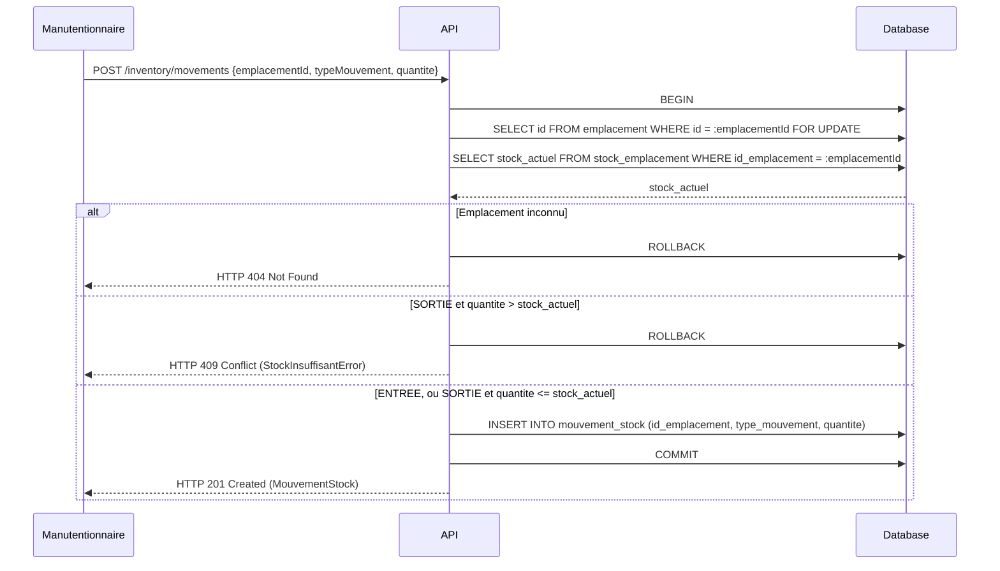

# Architecture comportementale

## Correspondance API ↔ base de données

L'API utilise le camelCase, la base le snake_case. Chaque champ correspond à une seule colonne :

| API (`03_api_contract.yaml`) | SQL (`01_database_schema.sql`) | Type API | Type SQL |
|---|---|---|---|
| `id` | `mouvement_stock.id` | `integer` (`int64`) | `BIGINT` |
| `emplacementId` | `mouvement_stock.id_emplacement` | `integer` (`int32`), `minimum: 1` | `INT`, clé étrangère vers `emplacement.id` |
| `typeMouvement` | `mouvement_stock.type_mouvement` | `enum: [ENTREE, SORTIE]` | `CHECK (type_mouvement IN ('ENTREE', 'SORTIE'))` |
| `quantite` | `mouvement_stock.quantite` | `integer` (`int32`), `minimum: 1` | `INT`, `CHECK (quantite > 0)` |
| `dateMouvement` | `mouvement_stock.date_mouvement` | `string` (`date-time`) | `TIMESTAMPTZ` |
| `stockActuel` | `stock_emplacement.stock_actuel` | `integer` | calculé par la vue |

## Déclaration d'un mouvement de stock

Le `SELECT ... FOR UPDATE` verrouille l'emplacement jusqu'au `COMMIT` ou au `ROLLBACK`. Si deux manutentionnaires déclarent une sortie sur le même emplacement au même moment, la seconde attend la fin de la première et lit le stock à jour : deux sorties ne peuvent pas passer ensemble sur un stock qui n'en couvre qu'une.
